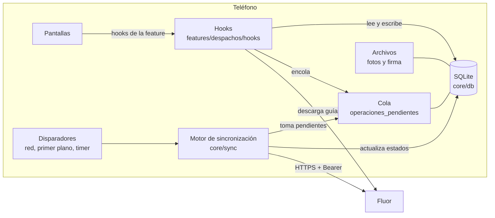
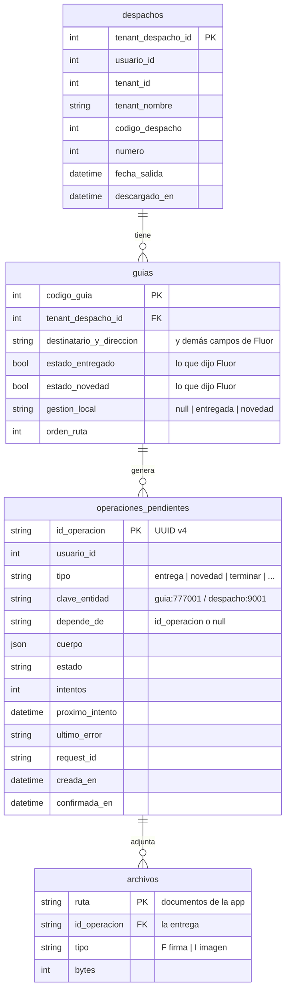
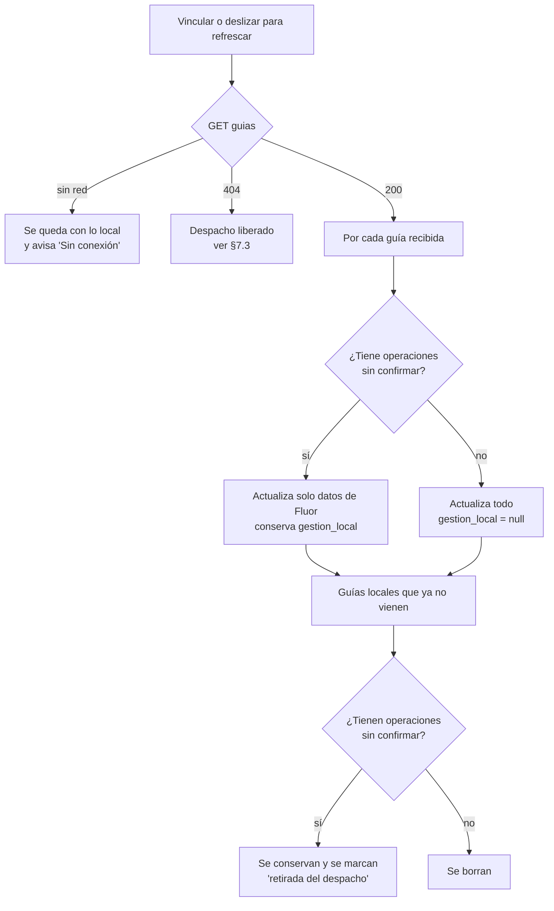
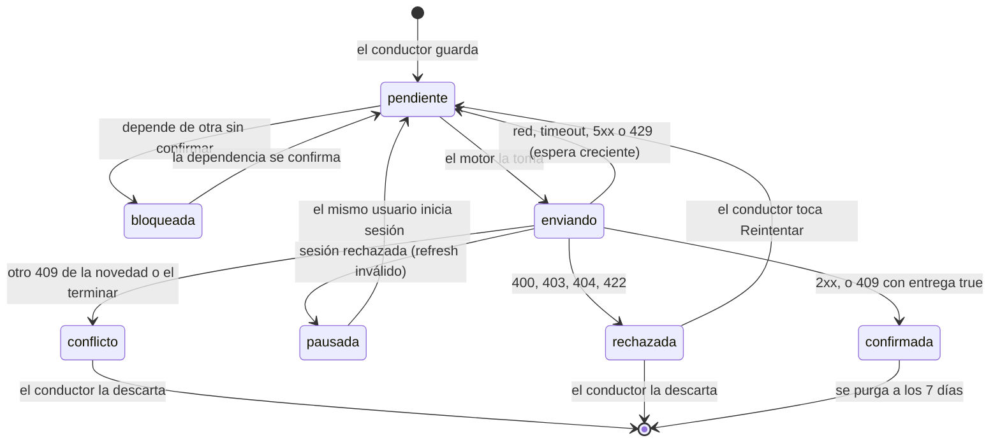
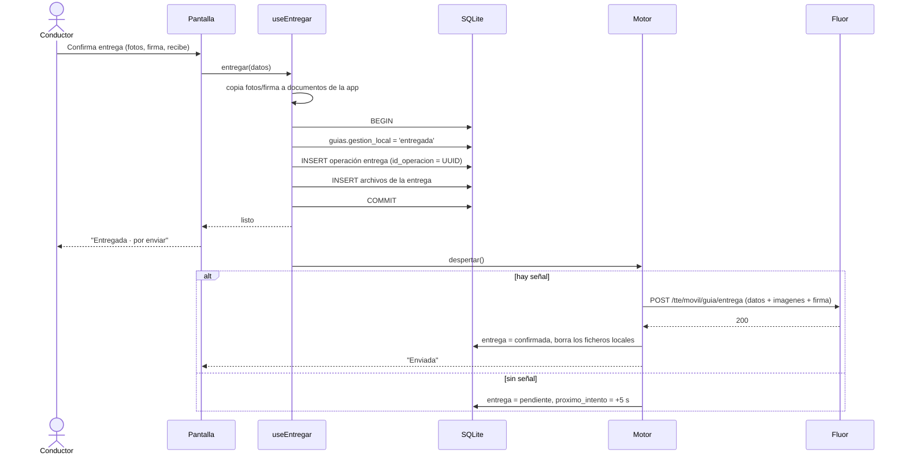
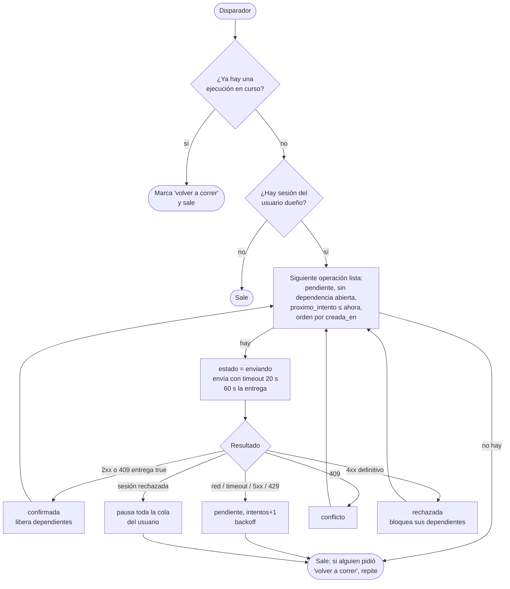
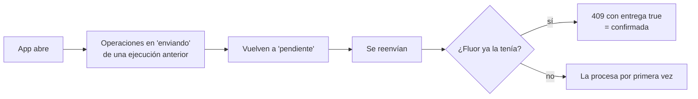
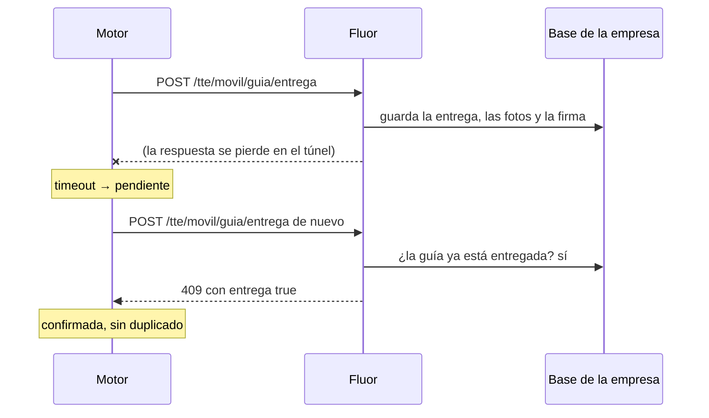
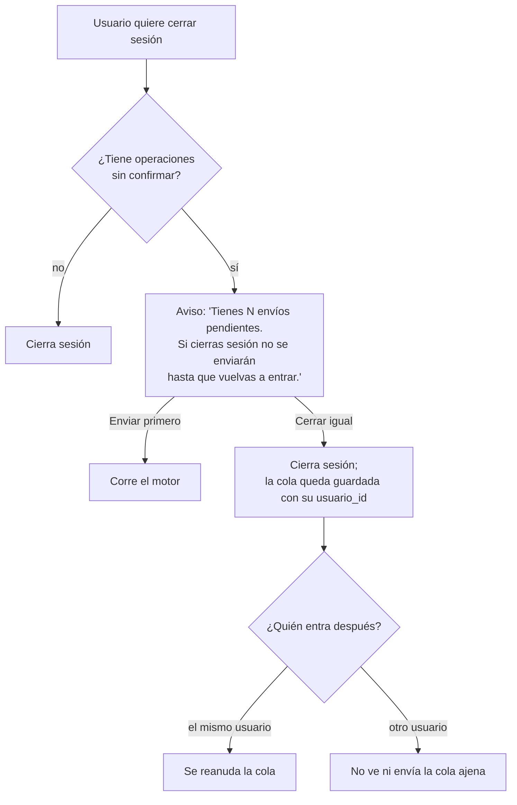

# Trabajo sin señal y sincronización

Cómo la app guarda y envía las entregas, novedades y demás acciones del conductor cuando la red falla: túneles, zonas rurales, señal intermitente, teléfono reiniciado.
Es el diseño que se implementa en `core/db` y `core/sync`. Cualquier cambio a estas reglas se discute aquí antes de tocar código.

> **6 nov 2026**: Fluor publicó `POST /tte/guia/entrega` (entrega, fotos y firma en una sola petición) y backend decidió no implementar `id_operacion` ni códigos de error propios. Este documento ya refleja esa decisión (§7.2, §7.3, §8 y §12).

> Los diagramas están en Mermaid: se ven en GitHub y en VS Code (con la vista previa de Markdown).

## 1. Garantías

Son las promesas que la app le hace al conductor y a la empresa. Todo el diseño existe para cumplirlas.

| # | Garantía | Cómo se cumple |
| --- | --- | --- |
| G1 | **Una entrega registrada nunca se pierde**, aunque se cierre la app, se apague el teléfono o se venza la sesión. | Se escribe en SQLite (transacción) antes de mostrar "Entregada". La cola solo borra una operación cuando Fluor la confirma. |
| G2 | **Una entrega nunca se registra dos veces** en Fluor, aunque se reenvíe. | Fluor bloquea la guía y responde `409` con `entrega: true` si ya estaba entregada. La app toma esa respuesta como confirmada (§7.2). El `id_operacion` (UUID v4) es la llave local de la cola; Fluor no lo recibe. |
| G3 | **El conductor nunca espera a la red** para seguir trabajando. | La pantalla lee y escribe en SQLite. La red solo la usa el motor de sincronización, en segundo plano. |
| G4 | **El conductor siempre sabe qué falta por enviar** y si algo falló. | Cada guía muestra su estado de envío; la pestaña *Envíos* lista la cola y los errores. |
| G5 | **Fluor es la verdad final.** | Si Fluor rechaza una operación de forma definitiva, la app no la oculta ni la reintenta para siempre: la marca y pide atención. |

Lo que **no** se garantiza:

- Que la app detecte que **otra persona** entregó la guía: Fluor responde igual a un reintento propio que a una entrega ajena, y la app la marca enviada (§7.3). Riesgo aceptado por backend el 6 nov 2026.
- Que la hora del teléfono sea correcta (§10).

## 2. Escenarios que cubre

| Escenario | Qué ve el conductor | Qué pasa por dentro |
| --- | --- | --- |
| Túnel de 30 s mientras entrega | Nada distinto: la guía queda "Entregada · por enviar". | La operación queda `pendiente`; se envía al volver la señal. |
| La señal se cae **justo después** de enviar (la respuesta no llega) | "Por enviar" unos segundos más. | Se reintenta; Fluor responde `409` con `entrega: true` y la app la marca enviada, sin duplicar (§7.2). |
| Zona rural varias horas | Barra "Sin conexión · 12 por enviar". | La cola crece; el motor reintenta con espera creciente. |
| Señal "falsa" (barras llenas, sin internet) | Igual que sin señal. | El motor no confía en el indicador de red: intenta, y el *timeout* lo clasifica como error de red. |
| El sistema cierra la app o el teléfono se reinicia | Al abrir, todo sigue ahí. | SQLite persiste; las operaciones que estaban `enviando` vuelven a `pendiente` (§6.4). |
| El access token (60 min) vence sin señal | Nada. | Al volver la red, el 401 dispara la renovación con el refresh token (ya implementado). |
| El refresh token (30 días) vence o lo revocan | Pide iniciar sesión, **sin perder** la cola. | La cola se pausa; al entrar el mismo usuario se reanuda (§9). |
| El control de la empresa libera el despacho mientras el conductor está sin señal | La guía queda en "No se pudo enviar". | Fluor responde 404; la operación queda `rechazada` con su evidencia guardada (§7.3). |
| Otro conductor u oficina ya entregó la guía | "Enviada", igual que un reintento propio. | `409` con `entrega: true` → `confirmada`. La evidencia local se conserva 7 días para soporte (§7.3). |
| Fluor guarda la entrega pero falla al guardar una foto o la firma | "Enviada". | `200` con `ficheros_con_error > 0` → `confirmada`; se reporta y los archivos locales se conservan 7 días. La recuperación la maneja backend (§8). |
| Se actualiza la app con envíos pendientes | Nada. | Las migraciones de SQLite conservan la cola (§11). |
| Poco espacio en el teléfono | Aviso antes de tomar fotos. | Se revisa el espacio libre antes de capturar (§8). |

## 3. Piezas

- **Pantallas**: no saben si hay red. Solo leen el estado local.
- **Hooks**: hacen la escritura local en una transacción y avisan al motor.
- **Motor** (`core/sync`): único lugar que envía escrituras a Fluor. Una sola ejecución a la vez.
- **Descarga** (`GET /tte/movil/guias` con `X-Tenant-Despacho-ID`): la hace el hook al vincular o al deslizar para refrescar, y fusiona con lo local (§5).

## 4. Modelo de datos local

Reglas del modelo:

- **Lo que dijo Fluor y lo que hizo el conductor van en columnas distintas.** `estado_entregado` se sobreescribe al descargar; `gestion_local` no. La pantalla muestra `gestion_local ?? estado del servidor`. Así una descarga nunca borra una entrega que aún no se envió.
- `usuario_id` en cada operación: el motor solo envía las del usuario con sesión (§9).
- Las fotos y la firma son **archivos de la operación de entrega**, no operaciones aparte: viajan en la misma petición (§8). Un archivo pertenece a **una sola** operación (`ruta` es la llave): la entrega de varias guías guarda una copia por guía (§6.5).
- `depende_de`: "terminar" no sale mientras haya entregas sin confirmar del despacho.
- Base en modo **WAL** y toda escritura del conductor en **una transacción**: guía + operación + archivos se guardan juntos o no se guarda nada.

## 5. Descarga de guías y fusión

- La fusión corre en **una transacción**: o queda la versión nueva completa o la anterior.
- Una guía que Fluor anuló o sacó del despacho no desaparece si el conductor ya la gestionó: la evidencia se conserva hasta resolverse.

## 6. Ciclo de vida de una operación

### 6.1 Estados

| Estado | Visible como | ¿El motor la reintenta sola? |
| --- | --- | --- |
| `pendiente` | "Por enviar" (gris) | Sí |
| `bloqueada` | "Por enviar" | Cuando se libere. No se guarda: se deduce de `depende_de` y de las operaciones anteriores de la misma entidad. |
| `enviando` | "Enviando…" | — |
| `confirmada` | "Enviada" (verde) | No |
| `pausada` | "Inicia sesión para enviar" | Al iniciar sesión |
| `rechazada` | "No se pudo enviar" (rojo) + motivo | No: requiere acción |
| `conflicto` | "Ya estaba gestionada" (amarillo) | No: requiere acción |

### 6.2 Entregar una guía (sin importar si hay señal)

Si la transacción falla (disco lleno, base corrupta), **no** se muestra "Entregada": se muestra el error y el formulario conserva lo capturado.

### 6.3 Motor de sincronización

- **Una ejecución a la vez** (candado en memoria). Varias señales seguidas no disparan envíos en paralelo.
- **Un error de red corta la ejecución entera**: si una falló por red, las siguientes también fallarían; se espera al próximo disparador.
- **Un rechazo no corta la cola**: solo bloquea las operaciones que dependen de la rechazada. Una novedad mal formada no frena las entregas de las demás guías.
- **Orden**: FIFO por `creada_en` (desempate por orden de inserción). Una operación no sale mientras haya una anterior de la misma entidad sin confirmar: dentro de una guía el orden importa (una novedad y luego la entrega).
- **Tipos sin enviador**: si la app aún no sabe enviar un tipo (p. ej. Fluor no publicó el endpoint), sus operaciones esperan en `pendiente` sin contar intentos.

**Disparadores**

| Disparador | Motivo |
| --- | --- |
| Se guardó una operación | El caso con señal: se envía al instante. |
| La red vuelve (NetInfo pasa a conectado) | Salir de un túnel. |
| La app pasa a primer plano | El sistema pudo haber pausado la app. |
| Cada 60 s mientras está en primer plano y hay pendientes | Red que no avisa el cambio (señal falsa). |
| Deslizar para refrescar / botón *Enviar ahora* en Envíos | Control manual del conductor. |
| Al iniciar sesión | Reanudar una cola pausada. |

NetInfo se usa **solo como disparador**, nunca para decidir "no intentar": su indicador de internet falla con portales cautivos y redes saturadas. La verdad es el resultado de la petición.

**Espera entre reintentos** (por operación): 5 s, 15 s, 1 min, 5 min, y luego 15 min como máximo, con ±20 % de variación para que muchos teléfonos no reintenten a la vez cuando Fluor vuelva de una caída. Un disparador de "la red volvió" o *Enviar ahora* ignora la espera.

### 6.4 Interrupciones a mitad de envío

Una operación solo queda en `enviando` si la app murió entre el envío y la respuesta. No se sabe si Fluor la recibió, y no importa: si ya la tenía responde `409` con `entrega: true` y la app la da por confirmada.

### 6.5 Entregar varias guías juntas

Varios paquetes del mismo cliente se entregan de una vez. En la lista del despacho, el conductor entra al modo selección con una pulsación larga en una guía o con el botón *Seleccionar varias guías*, y marca las guías tocándolas o escaneándolas. Captura una sola vez las fotos, quién recibe y la firma.

- **Una operación `entrega` por guía**, todas en **una transacción** (`registrarEntregas`), con la misma `fecha_entrega` y la misma ubicación. Si una guía no se puede entregar, no se guarda ninguna y el motivo dice cuál falla ("Guía 777002: La guía ya está entregada.").
- **Fluor no cambia**: recibe una petición `POST /tte/movil/guia/entrega` por guía. El motor, los reintentos, el `409` con `entrega: true` y los rechazos funcionan igual que con una guía; si Fluor rechaza una, las demás siguen.
- **Cada guía con su copia de la evidencia**: las fotos y la firma se mueven una vez a documentos y se copian para las demás guías (`copiarEvidencia`). Así confirmar una entrega borra solo sus archivos y no los de las otras. Costo: N × ~1 MB en disco y en datos.
- La selección es libre: puede mezclar destinatarios. El atajo "Recibe <titular>" aparece solo si todas las guías tienen el mismo destinatario, y el cobro que se muestra es la suma.
- **Novedad de varias guías**: queda preparada (`registrarNovedades`, ruta `Novedad` con `codigosGuia`) y se activa con `funciones.novedades` cuando Fluor publique el endpoint.

## 7. Errores

### 7.1 Clasificación

| Respuesta | Clase | Acción | Mensaje al conductor |
| --- | --- | --- | --- |
| Sin red, DNS, timeout | Transitorio | Reintentar con espera | "Sin conexión. Se enviará al volver la señal." |
| `5xx`, `502/503/504` | Transitorio | Reintentar con espera | "El servidor no responde. Reintentaremos." |
| `429` | Transitorio | Reintentar respetando `Retry-After` | (no se muestra) |
| `401` con refresh válido | Transparente | El cliente renueva y reintenta (ya implementado) | — |
| `401`/`403` del refresh | Sesión | `pausada`; pedir login | "Inicia sesión para enviar tus entregas." |
| `409` con `entrega: true` (entrega) | Ya aplicada | `confirmada` | "Enviada" |
| Otro `409` (p. ej. "La guía no está despachada") | Definitivo | `rechazada` | Mensaje de Fluor. |
| `404` (despacho liberado, guía inexistente) | Definitivo | `rechazada` | "El despacho ya no está asignado a ti." |
| `400`, `403`, `422` | Definitivo | `rechazada` + reporte a Sentry | Mensaje de Fluor (`mensajeUsuario`). |

Un `422` casi siempre es un error de la app (cuerpo mal armado), no del conductor: se reporta con `id_operacion` y `request_id`.

Fluor no manda códigos propios (`error.code` es genérico: `CONFLICT`, `NOT_FOUND`…). La app clasifica por el estado HTTP y, en la entrega, por la marca `entrega: true` del `409`. No se compara el texto del mensaje.

### 7.2 Respuesta perdida

Fluor bloquea la fila de la guía al entregar, así que dos envíos de la misma entrega nunca cuentan doble. Backend decidió no implementar `id_operacion` (6 nov 2026): con `entrega: true` la app sabe que la guía quedó entregada, aunque no sabe por quién (§7.3).

### 7.3 Conflictos y despachos liberados

- **Guía entregada por otro**: Fluor responde lo mismo que a un reintento propio (`409` con `entrega: true`), así que la app la marca `confirmada` y el conductor no ve un aviso. Las fotos, la firma y los datos de quien recibe **no** llegan a Fluor. Para no perder esa evidencia, la app conserva los archivos locales hasta que se purga la operación (7 días) y reporta el `409` a Sentry. Lo detecta y resuelve la oficina; es un riesgo aceptado por backend.
- **Despacho liberado** (`404` en cualquier operación del despacho): todas sus operaciones quedan `rechazada`; el despacho se muestra como "Liberado" y **no se borra** hasta que el conductor lo descarte o llame a la oficina. La evidencia (recibe, fotos, firma, hora) sigue en el teléfono y se puede exportar si hace falta.
- **Guía con novedad y luego entregada**: se envían en orden. Hoy Fluor no revisa la regla de entregar con novedad; la app la aplica antes de guardar.

## 8. Fotos y firma

- Se guardan en el **directorio de documentos** de la app, no en la caché (el sistema borra la caché cuando le falta espacio, y la app vieja perdía fotos así).
- Se comprimen al capturar (máx. 1.280 px, calidad de la configuración de entrega) para que una foto pese ~200 KB y suba con señal débil.
- Viajan **en la misma petición que la entrega** (`multipart/form-data`): `datos` (JSON), hasta 4 `imagenes` (JPEG, PNG o WebP) y una `firma` (PNG), máximo 30 MB en total. Con 1.280 px una entrega completa pesa alrededor de 1 MB.
- Fluor valida los archivos antes de tocar la guía: uno inválido rechaza la entrega completa (`400`/`422`) y no la deja a medias.
- Fluor sube los archivos **después** de guardar la entrega. Si uno falla responde `200` con `ficheros_con_error > 0`; la app no puede reenviarlo (reintentar daría `409`). Backend se encarga de ese caso. La app lo reporta a Sentry y conserva los ficheros locales hasta la purga (7 días).
- Con `ficheros_con_error = 0`, el fichero local se borra cuando la entrega queda `confirmada`.
- Antes de abrir la cámara se revisa que haya al menos 50 MB libres.
- En una entrega de varias guías, cada operación lleva su copia de la foto y la firma (§6.5). 5 guías con 4 fotos son unos 5 MB en el teléfono y 5 subidas de ~1 MB.

## 9. Sesión y cola

- La cola **nunca se envía con el token de otro usuario**: Fluor registra al usuario del JWT, así que enviarla con otra sesión cambiaría quién hizo la entrega.
- Si el refresh token vence en medio de una jornada sin señal, la app sigue funcionando offline. Pide login solo cuando necesita enviar.
- Cambiar de empresa no afecta a los despachos: el acceso es por la asignación (`tenant_despacho_id`).

## 10. Fechas y hora del teléfono

- Cada operación lleva la hora **del momento en que el conductor la hizo** (`fecha_entrega`, `fecha`), no la del envío. Una entrega hecha a las 10:42 en un túnel y enviada a las 11:30 queda a las 10:42.
- Fluor guarda la hora del servidor en el seguimiento (`fecha`) junto a la que manda el teléfono (`fecha_seguimiento` = `fecha_entrega`). Con eso la oficina ve cuándo llegó cada entrega.
- La hora del teléfono puede estar mal. Fluor no recibe `enviado_en`, así que no se corrige automáticamente.

## 11. Actualizaciones de la app y migraciones

- El esquema de SQLite se versiona con migraciones de drizzle que **nunca** borran `operaciones_pendientes` ni `archivos`.
- El `cuerpo` de cada operación se guarda ya armado (JSON listo para Fluor), con una versión de formato. Si una versión nueva cambia el contrato, las operaciones viejas se envían con su formato o se transforman en la migración.

## 12. Lo que esto exige a Fluor

### 12.1 Entrega: `POST /tte/movil/guia/entrega`

`multipart/form-data` con `datos` (JSON), `imagenes` (0 a 4) y `firma` (opcional). Respuesta `200`: `{codigo_guia_pk, estado_entregado, fecha_entrega, estado_digitalizado, estado_firma, ficheros_con_error}`.

| Campo de `datos` | Lo que manda la app |
| --- | --- |
| `guia` | `codigo_guia` (obligatorio) |
| `fecha_entrega` | Hora local del teléfono al confirmar, sin zona (`2026-11-06T10:42:13`) |
| `recibe`, `recibe_parentesco`, `recibe_numero_identificacion`, `recibe_celular` | Lo que capturó el conductor; los vacíos viajan como `null` |
| `latitud`, `longitud` | De la ubicación al confirmar; `null` sin GPS |
| `usuario`, `usuario_nombre`, `usuario_correo` | No se mandan: Fluor toma el usuario del token |

Va con `X-Tenant-Despacho-ID` = el id de la asignación (`mas_tenant_despacho`), que Fluor valida contra el usuario del token, y un timeout de 60 s, porque pesa alrededor de 1 MB. Se implementa en `features/despachos/api/entrega.ts` y `features/despachos/sync/enviadores.ts`.

| Respuesta | Qué hace la app |
| --- | --- |
| `200`, `ficheros_con_error = 0` | `confirmada`; borra los ficheros locales |
| `200`, `ficheros_con_error > 0` | `confirmada`; reporta y conserva los ficheros 7 días |
| `409` con `entrega: true` | `confirmada` (reintento propio u otra persona; no se distingue) |
| `409` sin `entrega` ("no está despachada", "El despacho está cerrado") | `rechazada` |
| `404` "Guía no encontrada" o "Despacho no encontrado" (asignación liberada) | `rechazada` |

### 12.2 Decidido por backend (6 nov 2026)

- **Sin `id_operacion`** ni `Idempotency-Key`: la idempotencia de la entrega sale de `409` + `entrega: true`.
- **Sin códigos de error propios**: la app clasifica por estado HTTP y la marca `entrega`.
- **Sin endpoint aparte para reenviar archivos**: si falla un archivo después de guardar la entrega, lo resuelve backend.

### 12.3 Pendiente en Fluor

1. **Acceso por asignación**: resuelto en `9ea5e66` con `POST /tte/movil/guia/entrega` y `X-Tenant-Despacho-ID`; valida también que la guía sea de ese despacho.
2. Endpoints de novedad, tipos de novedad, configuración de entrega y terminar despacho (`contratos-fluor.md`). Se espera el mismo patrón: un `409` reconocible cuando la acción ya estaba aplicada.
3. **Aceptar operaciones tardías** (por decidir): una entrega con `fecha_entrega` de ayer, o que llega después de que el despacho se terminó desde la web, no debería rechazarse por eso. Hoy `/tte/movil/guia/entrega` responde `409 "El despacho está cerrado"` antes de revisar si la guía ya estaba entregada, así que también rechaza el reenvío de una entrega que sí se guardó (sin `entrega: true`).
4. **`Retry-After` en los `429`.**
5. Que la descarga de guías (`/tte/movil/guias`) siga incluyendo las ya entregadas o con novedad, para que la fusión (§5) sepa qué confirmó el servidor (ya lo hace).

## 13. Lo que ve el conductor

- **Barra superior** cuando hay pendientes: "Sin conexión · 3 por enviar" o "Enviando 3…". Desaparece cuando la cola está vacía.
- **Cada guía** muestra su estado de envío (§6.1), no solo "Entregada".
- **Modo selección** en la lista del despacho (§6.5): casillas en lugar del número de parada, y una barra abajo con "2 guías · 4 und · cobrar $ 18.000" y el botón *Entregar 2 guías*. Las guías que no se pueden entregar se ven atenuadas y, al tocarlas, dicen por qué. Escanear suma la guía a la selección. *Cerrar* o el botón atrás de Android salen del modo.
- **Pantalla Envíos** (pestaña *Envíos*, o tocando el chip de envíos del encabezado): lista de la cola con estado, intentos y motivo del error; botones *Enviar ahora*, *Reintentar* y *Descartar* (este último pide confirmación y solo existe para `rechazada` y `conflicto`).
- **Terminar despacho** y **desvincular** se bloquean mientras haya operaciones sin confirmar del despacho, con el motivo visible.
- Si una operación lleva más de **24 h** sin confirmarse, aviso destacado: "Tienes entregas sin enviar desde ayer. Busca señal o avisa a la oficina."

## 14. Observabilidad

- Cada envío registra en Sentry (breadcrumb) `tipo`, `id_operacion`, `intentos` y el `request_id` de Fluor. Con eso backend encuentra la petición en sus logs.
- `rechazada` y `conflicto` se reportan como evento. Los errores de red no (son normales).
- Las operaciones confirmadas se purgan a los 7 días; mientras tanto sirven para soporte.

## 15. Envío en segundo plano

Primera versión: el motor corre **solo con la app abierta** (primer plano), más un intento al pasar a segundo plano. Es lo predecible en Android e iOS.
Después, si hace falta: Android WorkManager (tarea periódica con condición "hay red") para vaciar la cola con la app cerrada. iOS no garantiza tiempos de ejecución en segundo plano, así que no se promete.

## 16. Pruebas

| Prueba | Cómo |
| --- | --- |
| Motor, clasificación de errores, backoff, dependencias, fusión | Unitarias en Jest con SQLite en memoria y adaptador HTTP falso. |
| Respuesta perdida | Adaptador que guarda en el "servidor" y luego lanza timeout; verificar que el reenvío recibe `409` con `entrega: true` y queda `confirmada`. |
| Archivo fallido | Respuesta `200` con `ficheros_con_error: 1`; verificar `confirmada` y que los ficheros locales se conservan. |
| App cerrada a mitad de envío | Dejar una operación en `enviando`, reiniciar el motor, verificar que vuelve a `pendiente`. |
| Túnel real | Modo avión en el emulador mientras se entrega; quitarlo y ver que se envía. |
| Señal débil | Android Emulator → *Cellular* → *Network type* EDGE / *Signal* Poor. |
| Reinicio | Entregar sin señal, forzar cierre (`adb shell am force-stop com.semantica.cilog2`), abrir y verificar la cola. |
| Sesión vencida | Borrar el access token y dejar un refresh inválido; verificar `pausada` y que la cola sobrevive al login. |
| Varias guías | Una falla y no se guarda ninguna; confirmar una entrega no borra la copia de la otra. |

## 17. Decisiones abiertas

| Tema | Propuesta | Quién decide |
| --- | --- | --- |
| ¿Se permite terminar el despacho con entregas aún sin enviar? | No: terminar exige cola vacía del despacho. **Aplicado en la app** (paso 3a); falta que negocio lo confirme. | Negocio |
| ¿Idempotencia con `id_operacion`? | **Decidido**: no. Se usa `409` + `entrega: true` y se acepta no detectar entregas ajenas (§7.3). | Backend, 6 nov 2026 |
| ¿Reenviar archivos que fallaron? | **Decidido**: lo maneja backend; la app conserva los ficheros 7 días. | Backend, 6 nov 2026 |
| ¿Envío en segundo plano en Android desde la primera versión? | No; evaluarlo con el uso real. | Producto |
| Exportar la evidencia de un despacho liberado | Compartir un ZIP con JSON + fotos. | Producto |
