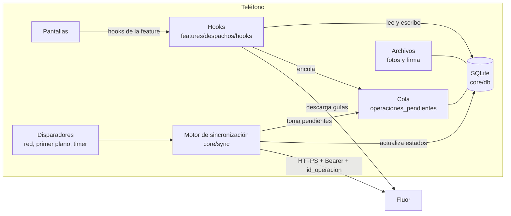
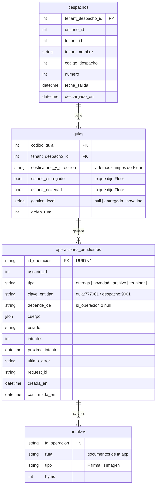
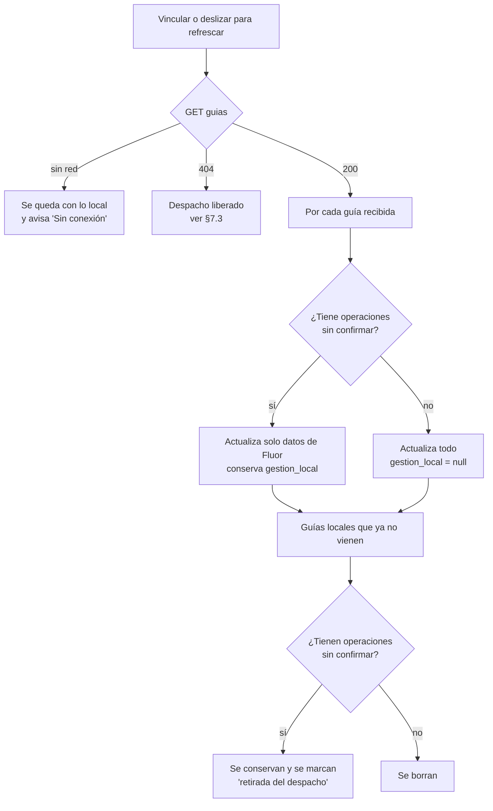
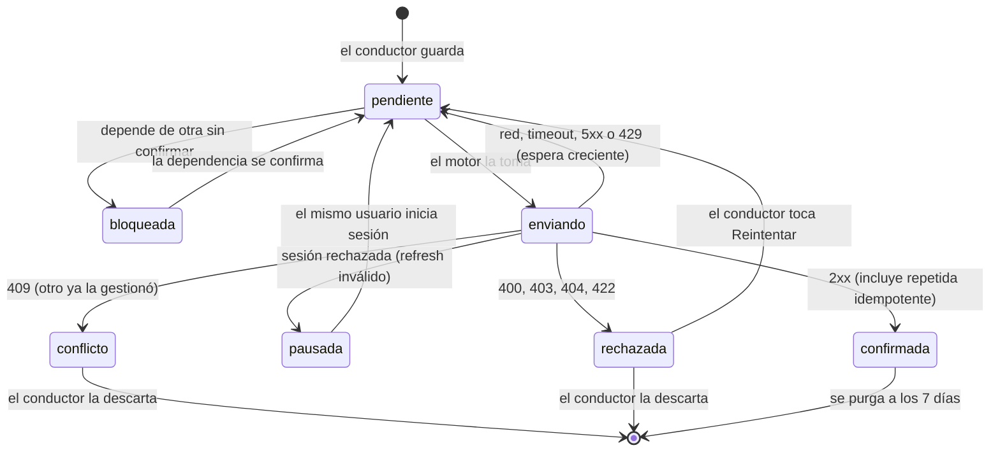
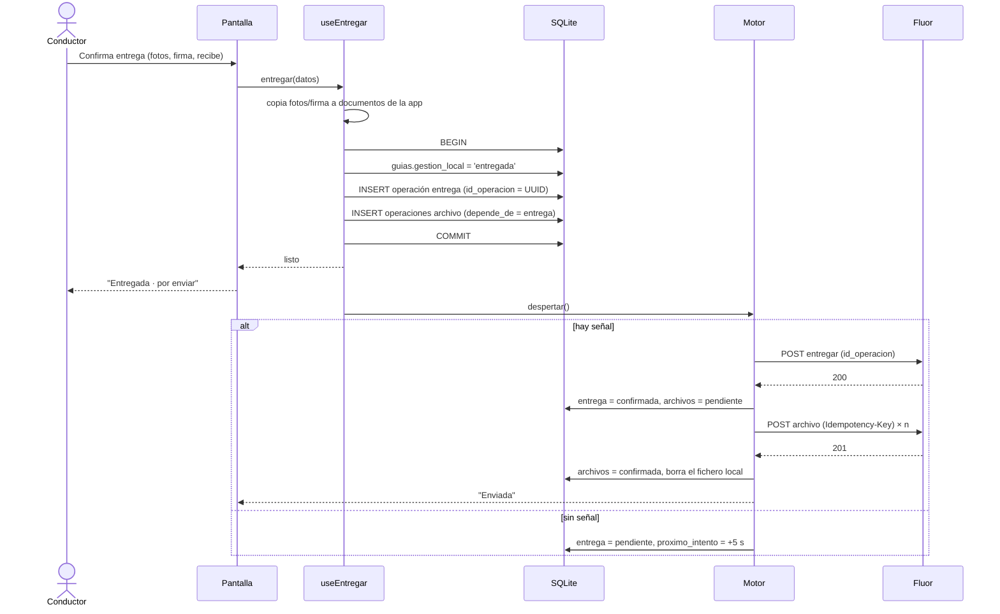
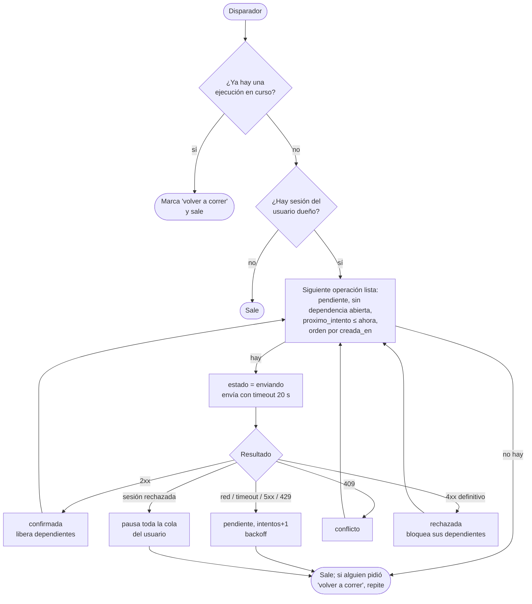
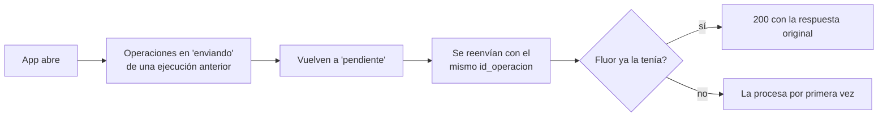
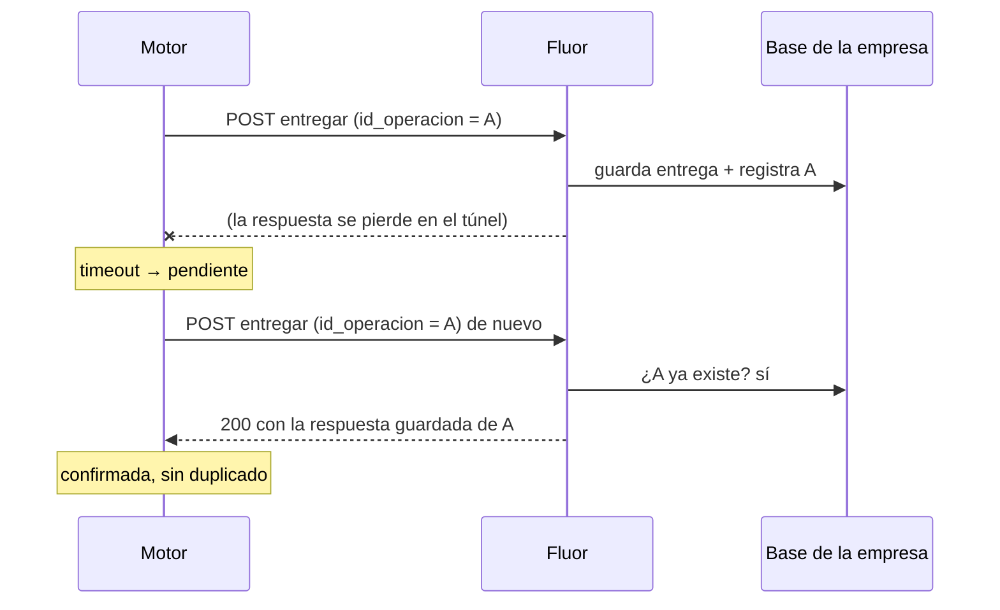
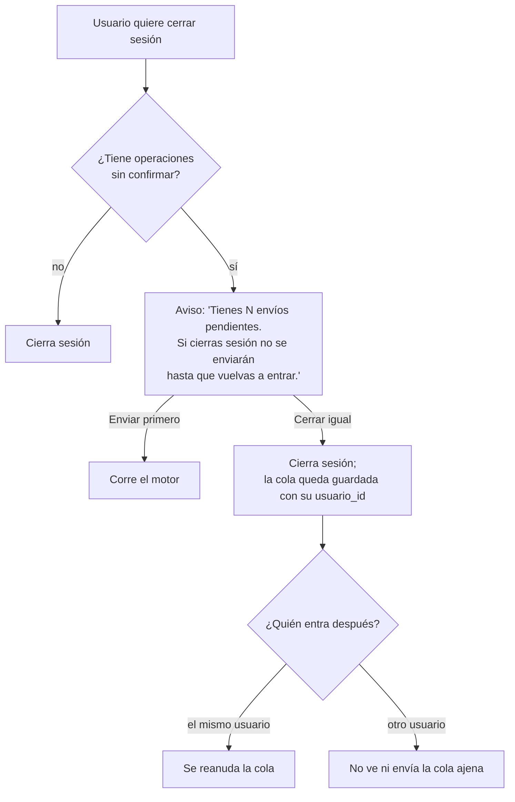

# Trabajo sin señal y sincronización

Cómo la app guarda y envía las entregas, novedades y demás acciones del conductor cuando la red falla: túneles, zonas rurales, señal intermitente, teléfono reiniciado.
Es el diseño que se implementa en `core/db` y `core/sync`. Cualquier cambio a estas reglas se discute aquí antes de tocar código.

> Los diagramas están en Mermaid: se ven en GitHub y en VS Code (con la vista previa de Markdown).

## 1. Garantías

Son las promesas que la app le hace al conductor y a la empresa. Todo el diseño existe para cumplirlas.

| # | Garantía | Cómo se cumple |
| --- | --- | --- |
| G1 | **Una entrega registrada nunca se pierde**, aunque se cierre la app, se apague el teléfono o se venza la sesión. | Se escribe en SQLite (transacción) antes de mostrar "Entregada". La cola solo borra una operación cuando Fluor la confirma. |
| G2 | **Una entrega nunca se registra dos veces** en Fluor, aunque se reenvíe. | Cada operación lleva un `id_operacion` (UUID v4) que Fluor usa como llave de idempotencia. |
| G3 | **El conductor nunca espera a la red** para seguir trabajando. | La pantalla lee y escribe en SQLite. La red solo la usa el motor de sincronización, en segundo plano. |
| G4 | **El conductor siempre sabe qué falta por enviar** y si algo falló. | Cada guía muestra su estado de envío; la pestaña *Envíos* lista la cola y los errores. |
| G5 | **Fluor es la verdad final.** | Si Fluor rechaza una operación de forma definitiva, la app no la oculta ni la reintenta para siempre: la marca y pide atención. |

Lo que **no** se garantiza: que dos conductores no entreguen la misma guía (lo decide Fluor con un `409`), ni que la hora del teléfono sea correcta (ver §10).

## 2. Escenarios que cubre

| Escenario | Qué ve el conductor | Qué pasa por dentro |
| --- | --- | --- |
| Túnel de 30 s mientras entrega | Nada distinto: la guía queda "Entregada · por enviar". | La operación queda `pendiente`; se envía al volver la señal. |
| La señal se cae **justo después** de enviar (la respuesta no llega) | "Por enviar" unos segundos más. | Se reintenta con el mismo `id_operacion`; Fluor responde 200 sin duplicar (§7.2). |
| Zona rural varias horas | Barra "Sin conexión · 12 por enviar". | La cola crece; el motor reintenta con espera creciente. |
| Señal "falsa" (barras llenas, sin internet) | Igual que sin señal. | El motor no confía en el indicador de red: intenta, y el *timeout* lo clasifica como error de red. |
| El sistema cierra la app o el teléfono se reinicia | Al abrir, todo sigue ahí. | SQLite persiste; las operaciones que estaban `enviando` vuelven a `pendiente` (§6.4). |
| El access token (60 min) vence sin señal | Nada. | Al volver la red, el 401 dispara la renovación con el refresh token (ya implementado). |
| El refresh token (30 días) vence o lo revocan | Pide iniciar sesión, **sin perder** la cola. | La cola se pausa; al entrar el mismo usuario se reanuda (§9). |
| El control de la empresa libera el despacho mientras el conductor está sin señal | La guía queda en "No se pudo enviar". | Fluor responde 404; la operación queda `rechazada` con su evidencia guardada (§7.3). |
| Otro conductor u oficina ya entregó la guía | "Ya estaba entregada". | `409` con otro `id_operacion` → `conflicto` (§7.3). |
| Se actualiza la app con envíos pendientes | Nada. | Las migraciones de SQLite conservan la cola (§11). |
| Poco espacio en el teléfono | Aviso antes de tomar fotos. | Se revisa el espacio libre antes de capturar (§8). |

## 3. Piezas

- **Pantallas**: no saben si hay red. Solo leen el estado local.
- **Hooks**: hacen la escritura local en una transacción y avisan al motor.
- **Motor** (`core/sync`): único lugar que envía escrituras a Fluor. Una sola ejecución a la vez.
- **Descarga** (`GET /tte/movil/despacho/{id}/guias`): la hace el hook al vincular o al deslizar para refrescar, y fusiona con lo local (§5).

## 4. Modelo de datos local

Reglas del modelo:

- **Lo que dijo Fluor y lo que hizo el conductor van en columnas distintas.** `estado_entregado` se sobreescribe al descargar; `gestion_local` no. La pantalla muestra `gestion_local ?? estado del servidor`. Así una descarga nunca borra una entrega que aún no se envió.
- `usuario_id` en cada operación: el motor solo envía las del usuario con sesión (§9).
- `depende_de`: una foto no se sube antes de que exista la entrega; "terminar" no sale mientras haya entregas sin confirmar del despacho.
- Base en modo **WAL** y toda escritura del conductor en **una transacción**: guía + operación + archivos se guardan juntos o no se guarda nada.

## 5. Descarga de guías y fusión

- La fusión corre en **una transacción**: o queda la versión nueva completa o la anterior.
- Una guía que Fluor anuló o sacó del despacho no desaparece si el conductor ya la gestionó: la evidencia se conserva hasta resolverse.

## 6. Ciclo de vida de una operación

### 6.1 Estados

| Estado | Visible como | ¿El motor la reintenta sola? |
| --- | --- | --- |
| `pendiente` | "Por enviar" (gris) | Sí |
| `bloqueada` | "Por enviar" | Cuando se libere. No se guarda: se deduce de `depende_de` y de las operaciones anteriores de la misma entidad. |
| `enviando` | "Enviando…" | — |
| `confirmada` | "Enviada" (verde) | No |
| `pausada` | "Inicia sesión para enviar" | Al iniciar sesión |
| `rechazada` | "No se pudo enviar" (rojo) + motivo | No: requiere acción |
| `conflicto` | "Ya estaba gestionada" (amarillo) | No: requiere acción |

### 6.2 Entregar una guía (sin importar si hay señal)

Si la transacción falla (disco lleno, base corrupta), **no** se muestra "Entregada": se muestra el error y el formulario conserva lo capturado.

### 6.3 Motor de sincronización

- **Una ejecución a la vez** (candado en memoria). Varias señales seguidas no disparan envíos en paralelo.
- **Un error de red corta la ejecución entera**: si una falló por red, las siguientes también fallarían; se espera al próximo disparador.
- **Un rechazo no corta la cola**: solo bloquea las operaciones que dependen de la rechazada. Una novedad mal formada no frena las entregas de las demás guías.
- **Orden**: FIFO por `creada_en` (desempate por orden de inserción). Una operación no sale mientras haya una anterior de la misma entidad sin confirmar: dentro de una guía el orden importa (una novedad y luego la entrega).
- **Tipos sin enviador**: si la app aún no sabe enviar un tipo (p. ej. Fluor no publicó el endpoint), sus operaciones esperan en `pendiente` sin contar intentos.

**Disparadores**

| Disparador | Motivo |
| --- | --- |
| Se guardó una operación | El caso con señal: se envía al instante. |
| La red vuelve (NetInfo pasa a conectado) | Salir de un túnel. |
| La app pasa a primer plano | El sistema pudo haber pausado la app. |
| Cada 60 s mientras está en primer plano y hay pendientes | Red que no avisa el cambio (señal falsa). |
| Deslizar para refrescar / botón *Enviar ahora* en Envíos | Control manual del conductor. |
| Al iniciar sesión | Reanudar una cola pausada. |

NetInfo se usa **solo como disparador**, nunca para decidir "no intentar": su indicador de internet falla con portales cautivos y redes saturadas. La verdad es el resultado de la petición.

**Espera entre reintentos** (por operación): 5 s, 15 s, 1 min, 5 min, y luego 15 min como máximo, con ±20 % de variación para que muchos teléfonos no reintenten a la vez cuando Fluor vuelva de una caída. Un disparador de "la red volvió" o *Enviar ahora* ignora la espera.

### 6.4 Interrupciones a mitad de envío

Una operación solo queda en `enviando` si la app murió entre el envío y la respuesta. No se sabe si Fluor la recibió, y no importa: la idempotencia hace seguro reenviarla.

## 7. Errores

### 7.1 Clasificación

| Respuesta | Clase | Acción | Mensaje al conductor |
| --- | --- | --- | --- |
| Sin red, DNS, timeout | Transitorio | Reintentar con espera | "Sin conexión. Se enviará al volver la señal." |
| `5xx`, `502/503/504` | Transitorio | Reintentar con espera | "El servidor no responde. Reintentaremos." |
| `429` | Transitorio | Reintentar respetando `Retry-After` | (no se muestra) |
| `401` con refresh válido | Transparente | El cliente renueva y reintenta (ya implementado) | — |
| `401`/`403` del refresh | Sesión | `pausada`; pedir login | "Inicia sesión para enviar tus entregas." |
| `409` y el cuerpo es de **otra** operación | Conflicto | `conflicto` | "Esta guía ya estaba entregada." |
| `404` (despacho liberado, guía inexistente) | Definitivo | `rechazada` | "El despacho ya no está asignado a ti." |
| `400`, `403`, `422` | Definitivo | `rechazada` + reporte a Sentry | Mensaje de Fluor (`mensajeUsuario`). |

Un `422` casi siempre es un error de la app (cuerpo mal armado), no del conductor: se reporta con `id_operacion` y `request_id`.

### 7.2 Respuesta perdida (la razón de `id_operacion`)

Sin esto, la app vieja podía registrar la misma entrega dos veces o marcar error una entrega que sí entró.

### 7.3 Conflictos y despachos liberados

- **Guía entregada por otro** (`409`): la guía muestra "Ya estaba gestionada". El conductor la descarta; las fotos y la firma locales se borran al descartar. Se reporta a Sentry para seguimiento.
- **Despacho liberado** (`404` en cualquier operación del despacho): todas sus operaciones quedan `rechazada`; el despacho se muestra como "Liberado" y **no se borra** hasta que el conductor lo descarte o llame a la oficina. La evidencia (recibe, fotos, firma, hora) sigue en el teléfono y se puede exportar si hace falta.
- **Guía con novedad y luego entregada**: se envían en orden. Si la empresa no permite entregar con novedad, Fluor responde `409` y queda `conflicto`.

## 8. Fotos y firma

- Se guardan en el **directorio de documentos** de la app, no en la caché (el sistema borra la caché cuando le falta espacio, y la app vieja perdía fotos así).
- Se comprimen al capturar (máx. 1.280 px, calidad de la configuración de entrega) para que una foto pese ~200 KB y suba con señal débil.
- Cada archivo es su propia operación con `depende_de` = la entrega. Si falla una foto, la entrega sigue confirmada y solo esa foto se reintenta.
- El fichero local se borra cuando su operación queda `confirmada`.
- Antes de abrir la cámara se revisa que haya al menos 50 MB libres.

## 9. Sesión y cola

- La cola **nunca se envía con el token de otro usuario**: Fluor registra al usuario del JWT, así que enviarla con otra sesión cambiaría quién hizo la entrega.
- Si el refresh token vence en medio de una jornada sin señal, la app sigue funcionando offline. Pide login solo cuando necesita enviar.
- Cambiar de empresa no afecta a los despachos: el acceso es por la asignación (`tenant_despacho_id`).

## 10. Fechas y hora del teléfono

- Cada operación lleva la hora **del momento en que el conductor la hizo** (`fecha_entrega`, `fecha`), no la del envío. Una entrega hecha a las 10:42 en un túnel y enviada a las 11:30 queda a las 10:42.
- La hora del teléfono puede estar mal. Se envía también `enviado_en` (hora del teléfono al enviar) para que Fluor pueda corregir: `hora_real ≈ fecha_entrega + (recibido_en_servidor − enviado_en)`. Se pide a Fluor guardar `recibido_en` (§12).

## 11. Actualizaciones de la app y migraciones

- El esquema de SQLite se versiona con migraciones de drizzle que **nunca** borran `operaciones_pendientes` ni `archivos`.
- El `cuerpo` de cada operación se guarda ya armado (JSON listo para Fluor), con una versión de formato. Si una versión nueva cambia el contrato, las operaciones viejas se envían con su formato o se transforman en la migración.

## 12. Lo que esto exige a Fluor

Para que las garantías se cumplan, cada endpoint de escritura debe:

1. **Idempotencia por `id_operacion`**: si ya lo procesó, responder 200 con la misma respuesta (ya está en `contratos-fluor.md`). Debe guardarse por al menos 30 días: un teléfono puede volver a enviar después de días sin señal.
2. **`409` solo cuando otra operación** ya gestionó la entidad, con un `code` distinguible (`YA_ENTREGADA`, `DESPACHO_LIBERADO`…) para que la app no dependa del texto.
3. **Aceptar operaciones tardías**: una entrega con `fecha_entrega` de ayer, o que llega después de que el despacho se terminó desde la web, no debe rechazarse por eso.
4. **Guardar `recibido_en`** (hora del servidor) junto a la hora que reporta el teléfono.
5. **`Retry-After` en los `429`.**
6. **Entrega antes que archivos**: `POST /doc/fichero/cargar` con `Idempotency-Key` y `tipo` (contrato 5).
7. Que la descarga de guías (`/tte/movil/despacho/{id}/guias`) incluya las guías ya entregadas o con novedad (ya lo hace) para que la fusión (§5) sepa qué confirmó el servidor.

## 13. Lo que ve el conductor

- **Barra superior** cuando hay pendientes: "Sin conexión · 3 por enviar" o "Enviando 3…". Desaparece cuando la cola está vacía.
- **Cada guía** muestra su estado de envío (§6.1), no solo "Entregada".
- **Pestaña Envíos**: lista de la cola con estado, intentos y motivo del error; botones *Enviar ahora*, *Reintentar* y *Descartar* (este último pide confirmación y solo existe para `rechazada` y `conflicto`).
- **Terminar despacho** y **desvincular** se bloquean mientras haya operaciones sin confirmar del despacho, con el motivo visible.
- Si una operación lleva más de **24 h** sin confirmarse, aviso destacado: "Tienes entregas sin enviar desde ayer. Busca señal o avisa a la oficina."

## 14. Observabilidad

- Cada envío registra en Sentry (breadcrumb) `tipo`, `id_operacion`, `intentos` y el `request_id` de Fluor. Con eso backend encuentra la petición en sus logs.
- `rechazada` y `conflicto` se reportan como evento. Los errores de red no (son normales).
- Las operaciones confirmadas se purgan a los 7 días; mientras tanto sirven para soporte.

## 15. Envío en segundo plano

Primera versión: el motor corre **solo con la app abierta** (primer plano), más un intento al pasar a segundo plano. Es lo predecible en Android e iOS.
Después, si hace falta: Android WorkManager (tarea periódica con condición "hay red") para vaciar la cola con la app cerrada. iOS no garantiza tiempos de ejecución en segundo plano, así que no se promete.

## 16. Pruebas

| Prueba | Cómo |
| --- | --- |
| Motor, clasificación de errores, backoff, dependencias, fusión | Unitarias en Jest con SQLite en memoria y adaptador HTTP falso. |
| Respuesta perdida | Adaptador que guarda en el "servidor" y luego lanza timeout; verificar que el reenvío no duplica. |
| App cerrada a mitad de envío | Dejar una operación en `enviando`, reiniciar el motor, verificar que vuelve a `pendiente`. |
| Túnel real | Modo avión en el emulador mientras se entrega; quitarlo y ver que se envía. |
| Señal débil | Android Emulator → *Cellular* → *Network type* EDGE / *Signal* Poor. |
| Reinicio | Entregar sin señal, forzar cierre (`adb shell am force-stop com.plutonio`), abrir y verificar la cola. |
| Sesión vencida | Borrar el access token y dejar un refresh inválido; verificar `pausada` y que la cola sobrevive al login. |

## 17. Decisiones abiertas

| Tema | Propuesta | Quién decide |
| --- | --- | --- |
| ¿Se permite terminar el despacho con entregas aún sin enviar? | No: terminar exige cola vacía del despacho. | Negocio |
| ¿Cuánto tiempo guarda Fluor los `id_operacion`? | 30 días. | Backend |
| ¿Envío en segundo plano en Android desde la primera versión? | No; evaluarlo con el uso real. | Producto |
| Exportar la evidencia de un despacho liberado | Compartir un ZIP con JSON + fotos. | Producto |
